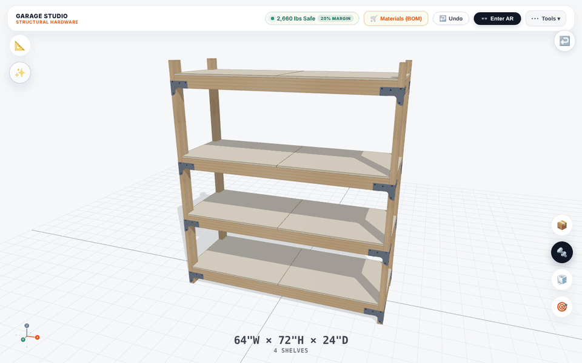

# Garage Studio



**Design garage shelving in 3D, check the load, then see it in your garage in AR.**

Pick a size (or a preset), and Garage Studio builds the shelving unit out of real dimensional lumber and
structural connectors: posts, rails, decking, corner ties and screws, all in 3D. It estimates how much each
shelf can hold as you change it, writes the shopping list and the assembly plan, and on a phone it places the
unit at full size against your garage wall.

Created by **Mike Warren** ([@dinosaurmike](https://github.com/dinosaurmike)). It's the "AR Organizer" on my
profile.

**Try it: <https://dinomike.ca/GarageStudio/>** (on a desktop, scan the QR code to continue on your phone in AR)

---

## What it does

**Design**
- Width, height, depth and number of shelves, or start from a preset: tote storage, workbench, full wall,
  tool bay, or tires.
- A step-by-step wizard: what are you storing, how big is the wall, then place it in AR.
- Click a shelf to move it up or down, add or delete tiers, and add full-height columns or partial dividers.
- Show 27-gallon storage totes, the screws, or a wireframe of just the framing and connectors.

**Check the load**
- A live **estimated safe working load** for the whole unit and each shelf (with a 20% safety reduction),
  based on the lumber, spans and connectors. Tap it to see what limits the capacity and why the unit must be
  anchored to the wall.
- A hardware catalog with each connector in 3D, its allowable loads and its code-report references.

**Build it**
- A materials list with quantities and prices, grouped by store department with aisle and bay, ready to
  download as CSV, print as a pick sheet or send to a retailer's cart.
- A step-by-step **assembly PDF**, and a link to share the design.

**See it in your garage (WebXR AR)**
- Set the floor, then anchor the unit to the wall; nudge it up or down, rotate it or snap it square to the wall.
- Edit shelves and columns in AR, toggle the totes and the wireframe, and check it at 1:1 scale.

> The load figures are estimates from the app's own calculation, a design aid rather than an engineering
> approval. Follow the manufacturer's instructions for every connector and anchor, and anchor the unit to wall
> studs. Prices, aisle locations and discounts in the materials list are sample data, not live store data.

## How it's built

- A JavaScript web app built with **Vite**: `index.html`, one bundled module (`assets/index-<hash>.js`) and
  its stylesheet.
- **Three.js** for the 3D model, **WebXR** (`immersive-ar` with hit-testing) for AR.
- A parametric model: every post, rail, deck panel, connector and screw is generated from the dimensions and
  shelf layout, so the 3D view, the load estimate, the materials list and the PDF always agree.
- Optional manufacturer CAD models of the connectors load from `models/` when present (see
  [models/README.md](models/README.md)); otherwise the app draws its own.

### What's in this repository

```
index.html          the app (loads assets/)
assets/             the built bundle and stylesheet
models/             where optional manufacturer CAD models go (not included)
qr_code.png         "continue on your phone" QR code (links to dinomike.ca/GarageStudio/)
docs/images/        README header (GIF) and social preview, with the scripts that make them (source/)
```

This is the **built** app, ready to host. The original source project isn't included here yet. To run it
locally, serve the folder (`python3 -m http.server 8000`) and open <http://localhost:8000>. AR needs a phone
and an HTTPS page.

## Notes

Garage Studio is a personal project. Product names and part numbers it refers to (Simpson Strong-Tie
connectors and fasteners; The Home Depot and Lowe's) are trademarks of their owners. The project is not
affiliated with or endorsed by them.

## License

© 2026 Mike Warren. All rights reserved. The code is shared here so you can see the work; it isn't licensed
for reuse. See [LICENSE](LICENSE).
